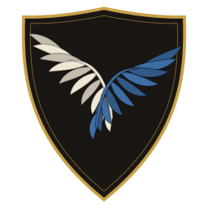
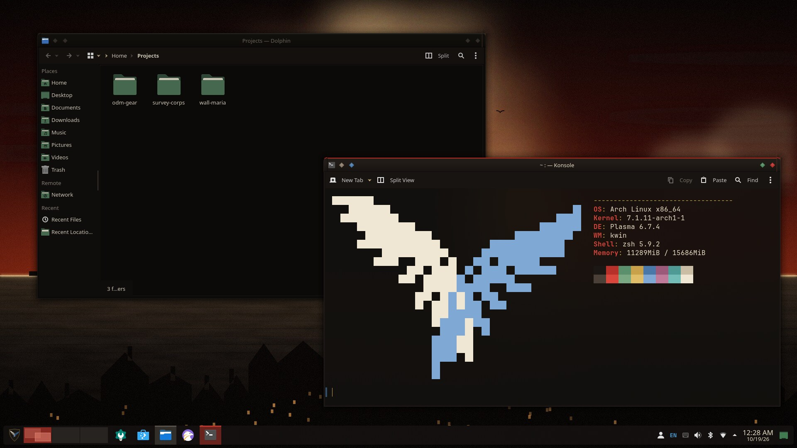
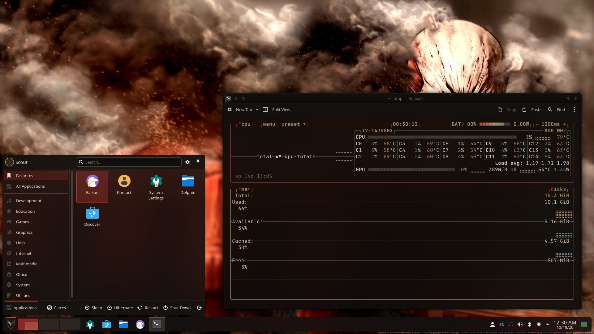
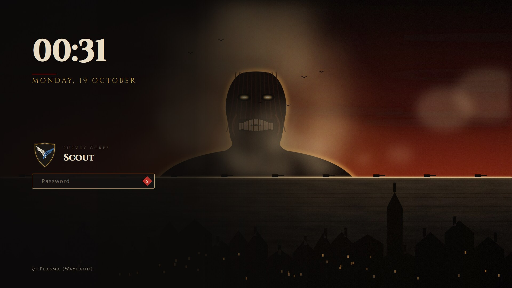
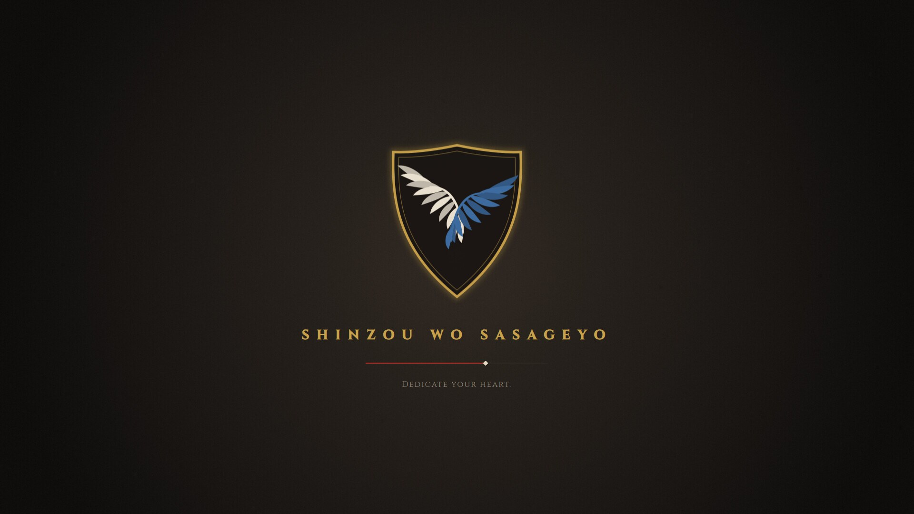
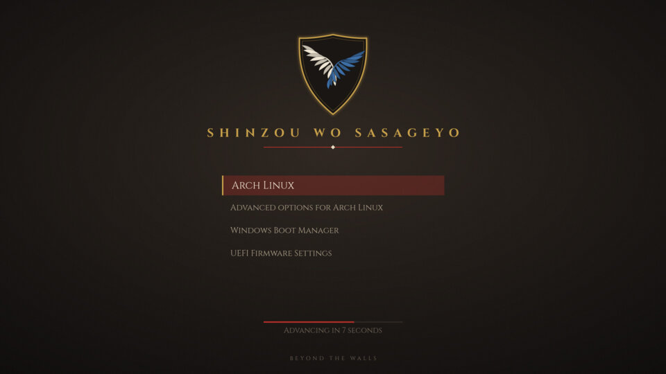
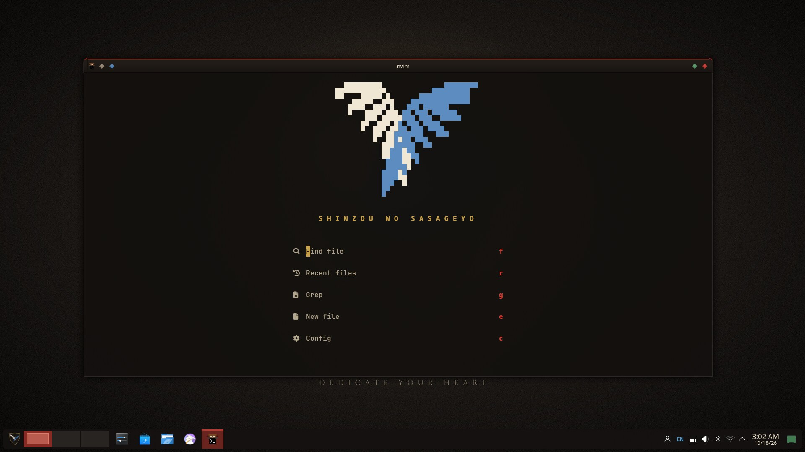
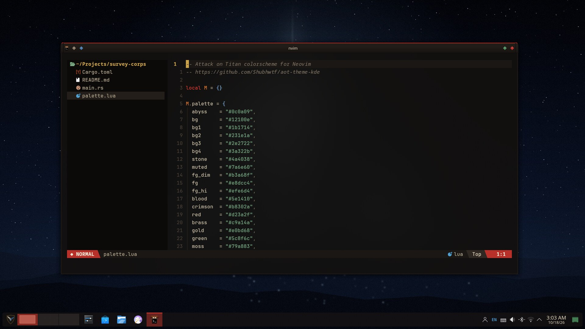
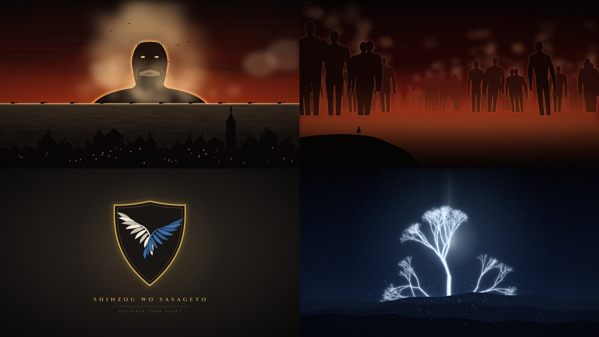

<div align="center">



# Attack on Titan for KDE Plasma

**Shinzou wo Sasageyo.** A complete Survey Corps desktop for KDE Plasma 6.
Everything from the boot menu to your terminal, in leather, steel, brass and blood.



</div>

## What's inside

| Component | Description |
|---|---|
| **Global theme** | One click in System Settings switches every piece below |
| **Color scheme** | Warm near-black leather, parchment text, crimson selection, brass and Survey Corps green accents |
| **Plasma style** | Panels, popups and widgets that follow the palette, plus a custom busy spinner |
| **Window decoration** | Aurorae theme with a dark leather titlebar, crimson top edge and diamond buttons (green minimize, brass maximize, crimson close) |
| **Application style** | Kvantum theme (optional; Breeze also works with the color scheme) |
| **Icons** | Survey Corps green folders (built on Papirus) and the wings emblem as your app launcher |
| **Wallpapers** | Four original 4K wallpapers: *Wall Maria*, *The Rumbling*, *Wings of Freedom*, *Paths* |
| **Splash screen** | Animated emblem, Cinzel type and a crimson progress line |
| **Login screen** | SDDM (Qt 6) theme with a big clock, emblem and a shake-on-wrong-password field |
| **Boot** | GRUB theme and a Plymouth splash with a breathing emblem and password prompt |
| **Terminals** | Konsole, Kitty and btop color themes, plus a neofetch wings logo |
| **Neovim** | `attack-on-titan` colorscheme (treesitter, LSP, telescope, neo-tree, lualine, bufferline) and a full config with a wings dashboard |
| **Kitty config** | Powerline tabs, cursor trail, blur and the AoT palette |
| **4K fan wallpapers** | A script that pulls the top-rated 4K Attack on Titan wallpapers from wallhaven for your personal use |

## Screenshots

<table>
<tr><td></td><td></td></tr>
<tr><td align="center">Launcher, panel and btop on <i>The Rumbling</i></td><td align="center">SDDM login</td></tr>
<tr><td></td><td></td></tr>
<tr><td align="center">Plasma splash</td><td align="center">GRUB</td></tr>
</table>

<table>
<tr><td></td><td></td></tr>
<tr><td align="center">Neovim dashboard in kitty</td><td align="center">Neovim with neo-tree and lualine</td></tr>
</table>

### Wallpapers



Want official-style art too? Fetch the top-rated 4K Attack on Titan wallpapers from [wallhaven](https://wallhaven.cc) into `~/.local/share/wallpapers/AttackOnTitan-Collection`, where Plasma's wallpaper picker finds them:

```bash
./scripts/fetch-wallpapers.py --count 18
```

They are not bundled here because they belong to their artists.

## Install

Requirements: KDE Plasma 6. Optional: `kvantum` for the widget style, `papirus-icon-theme` for non-folder icons, `plymouth` for the boot splash.

```bash
git clone https://github.com/Shubhwtf/aot-theme-kde.git
cd aot-theme-kde

./install.sh --apply              # install and switch to the theme (your configs are backed up first)
./install.sh --apply --kvantum    # same, using the Kvantum widget style
sudo ./install.sh --system        # login screen, GRUB and Plymouth
./install.sh --dotfiles           # kitty.conf + Neovim config (backed up first)
```

`./install.sh` with no option only installs the files. You can then pick **Attack on Titan** in *System Settings › Colors & Themes › Global Theme*.

Choose a different wallpaper with `--wallpaper Rumbling` (or `WingsOfFreedom`, `Paths`, `WallMaria`).

<details>
<summary><b>Plymouth notes</b></summary>

The installer only rebuilds your initramfs when the `plymouth` hook is already in `/etc/mkinitcpio.conf`. Otherwise add it to `HOOKS` after `systemd` (or `udev`), add `splash` to your kernel command line, and run `sudo mkinitcpio -P`.
</details>

<details>
<summary><b>Terminals</b></summary>

- **Konsole**: the installer sets the color scheme on your default profile. A ready-made `Attack on Titan` profile is also installed.
- **Kitty**: `include themes/attack-on-titan.conf` is appended to `kitty.conf`.
- **btop**: `color_theme` is set to `attack-on-titan`.
- **neofetch**: see [`terminal/neofetch/README.txt`](terminal/neofetch/README.txt).
</details>

<details>
<summary><b>Neovim</b></summary>

`dotfiles/nvim` is a complete lazy.nvim config (Neovim 0.11+): telescope, neo-tree, the new `main` branch of nvim-treesitter, lualine, bufferline, alpha dashboard, gitsigns, which-key, indent guides and autopairs. It needs a Nerd Font and the `tree-sitter` CLI (`npm i -g tree-sitter-cli` or `pacman -S tree-sitter-cli`).

Only want the colors? Copy `dotfiles/nvim/colors` and `dotfiles/nvim/lua/aot` into your config and run `:colorscheme attack-on-titan`. The lualine theme lives in `dotfiles/nvim/lua/lualine/themes`.

| Key | Action |
|---|---|
| `Ctrl-p` | find files |
| `Space f g` / `f b` / `f r` | grep / buffers / recent files |
| `Ctrl-n` | file tree |
| `Shift-h` / `Shift-l` | previous / next buffer |
</details>

## Uninstall

```bash
./uninstall.sh            # removes the files and switches back to Breeze Dark
sudo ./uninstall.sh --system
```

Your original configs stay in `~/.aot-backup-<date>` if you want to restore them by hand.

## Palette

| | Name | Hex |
|---|---|---|
|  | Leather (window) | `#141110` |
|  | Abyss (view) | `#110f0d` |
|  | Parchment (text) | `#e8dcc4` |
|  | Blood (selection) | `#a8211b` |
|  | Crimson (focus) | `#d23a2f` |
|  | Brass (ODM gear) | `#c9a14a` |
|  | Survey Corps green | `#427a52` |
|  | Wings blue | `#4a78a8` |
|  | Titan steam | `#d9782d` |

## Building from source

The wallpapers, emblem, window decoration, icons and Kvantum theme are generated by the scripts in [`src/`](src), so the whole look can be re-tuned from code:

```bash
python3 src/wallpapers.py .                       # needs numpy, pillow, rsvg-convert and the Cinzel font
python3 src/aurorae.py .
python3 src/icons.py . /usr/share/icons/Papirus
python3 src/kvantum.py .
```

## Credits

- Fan-made, non-commercial tribute to *Attack on Titan* (Shingeki no Kyojin) by Hajime Isayama. All artwork in this repository is original and drawn from code; it is not affiliated with or endorsed by the rights holders.
- [Cinzel](https://github.com/NDISCOVER/Cinzel) font by Natanael Gama, SIL Open Font License.
- Folder glyphs from [Papirus](https://github.com/PapirusDevelopmentTeam/papirus-icon-theme) (GPL-3.0).
- Kvantum theme derived from KvArcDark by Tsu Jan (GPL-3.0).
- Plasma style falls back to KDE's Breeze.

Licensed under the [GPL-3.0](LICENSE).
